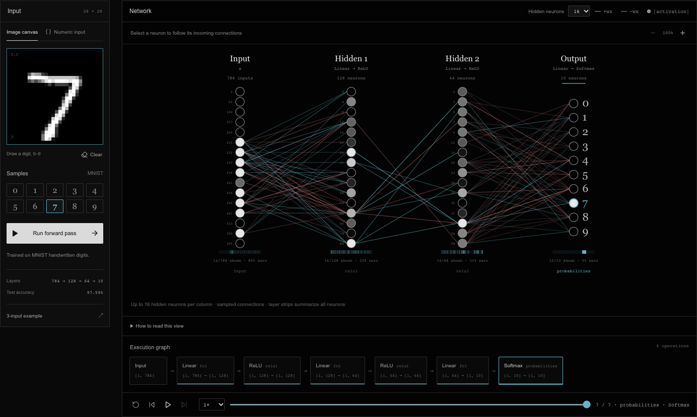
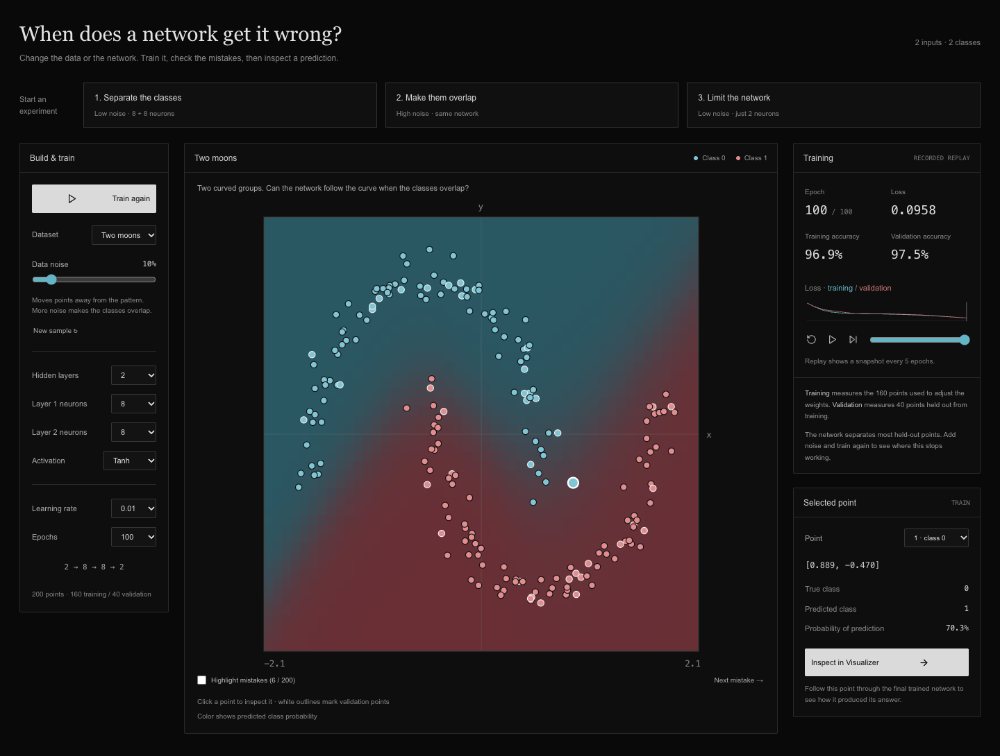

# NeuralScope

**Watch a neural network make a prediction, then inspect what each layer actually computed.** NeuralScope is a small, open-source Visualizer and training Playground. It runs real PyTorch models; the animation replays a recorded forward pass.

[Try the live Visualizer](https://neuralscope-smoky.vercel.app/#/visualizer) · [Open the Playground](https://neuralscope-smoky.vercel.app/#/playground) · [Report a bug](https://github.com/EmmetSurmeli/Neural-Network-Visualizer/issues)



## Try it in a minute

1. Open the [Visualizer](https://neuralscope-smoky.vercel.app/#/visualizer). The digit **7** sample is ready; click **Run forward pass**. The bundled MNIST model predicts **7** at about **99.73%** probability for this sample.
2. Play or scrub the execution graph. Select a layer for activations and statistics, then select a neuron to inspect its incoming weighted contributions. Switch between 16 and 32 displayed hidden neurons.
3. Open the [Playground](https://neuralscope-smoky.vercel.app/#/playground), change the dataset or noise, and train a small 2D classifier. Select a point and choose **Inspect in Visualizer** to follow its prediction through the trained model.

The free backend can take a minute to wake after inactivity. The page retries briefly and keeps the examples and format guide available while it starts.

## What the views mean

The Visualizer records the actual order, tensor shapes, activations, and output of a PyTorch forward pass. Neuron values come from that run. Cyan and red connections represent positive and negative **input × weight** contributions to a Linear neuron; the inspector also includes its bias. CNN stages show recorded feature maps.

Large layers and dense connections are sampled to fit the screen. Hidden columns show up to 32 real neuron indices, while the full model still computes every neuron. The moving signals and fades illustrate the recorded operation order; they are not measured travel times or a claim that neurons fire one at a time. CNN receptive-field connections are not drawn as dense edges. [Fidelity tests](backend/tests/test_fidelity.py) compare layer outputs and displayed values against independent NumPy calculations.

The Playground trains a binary classifier on 200 generated points: XOR, two moons, circles, or spiral. Noise, network width/depth, activation, learning rate, and training length are adjustable. Its boundary animation replays snapshots recorded every five epochs after training finishes. The selected point always opens the **final** trained model in the Visualizer.



## Models and input formats

Five examples are bundled: a trained MNIST digit MLP, two small synthetic-image CNNs, XOR, and a three-input ReLU classifier. MNIST test accuracy is **97.59%** on 10,000 held-out images. The CNNs score 100% on their separate *generated* evaluation images; that does not measure performance on real drawings. [Model metadata](backend/models/metadata.json) and [training scripts](scripts) document how these checkpoints were produced.

To inspect your own model, import a **declarative JSON description of a feed-forward `nn.Sequential` model**. Supported layers are Linear, ReLU, Sigmoid, Tanh, Softmax, Dropout in evaluation mode, and Flatten. Start with [tiny-model.json](examples/tiny-model.json), [xor-model.json](examples/xor-model.json), or [tanh-classifier.json](examples/tanh-classifier.json); the in-app **Format** guide explains the schema. The tiny model accepts `[1, 0.5, -1]` and predicts class 0 at about 96.85%.

ONNX, raw PyTorch checkpoints, pickle, custom Python, branches, recurrent networks, and transformers are not importable. Imports are checked against size, shape, layer, parameter, and numeric limits before use. Uploaded models, inputs, and traces are processed in temporary **server memory**, not entirely in the browser; there is no account or saved history. See [privacy and retention](PRIVACY.md) and [service limits](OPERATIONS.md).

## Run locally

Use Python 3.11+ and Node.js 20.19+ (Node 22.12+ also works). From the repository root:

```bash
./start.sh
```

Open <http://127.0.0.1:8000>. The script creates a virtual environment if needed, installs missing dependencies, builds the frontend, and starts the local API. The included checkpoints and samples work without downloading a dataset. For separate frontend/backend development servers, see [DEPLOYMENT.md](DEPLOYMENT.md#local-development-and-checks).

Run the checks with:

```bash
.venv/bin/python -m pytest backend/tests -q
npm test --prefix frontend
npm run build --prefix frontend
npm run test:browser --prefix frontend
```

The browser suite needs Chromium installed by Playwright; GitHub Actions installs it automatically. CI also builds and smokes the production Docker image. The API's interactive documentation is available at <http://127.0.0.1:8000/docs> in development and disabled on the public service.

## Project and deployment

The frontend is React, TypeScript, and Vite; the backend is FastAPI and PyTorch. [Forward hooks](backend/instrumentation/trace.py) capture execution, [model import](backend/services/models.py) builds only supported layers, and [tests](backend/tests) verify inference, session isolation, limits, and visualization fidelity. The public site uses Vercel and a single-worker Render service because models and traces live in process memory. [Deployment](DEPLOYMENT.md), [operations](OPERATIONS.md), and the [public-demo checklist](LAUNCH.md) explain that setup.

Issues and small contributions are welcome; read [CONTRIBUTING.md](CONTRIBUTING.md) first. Please report security issues privately as described in [SECURITY.md](SECURITY.md). Licensed under [MIT](LICENSE).
